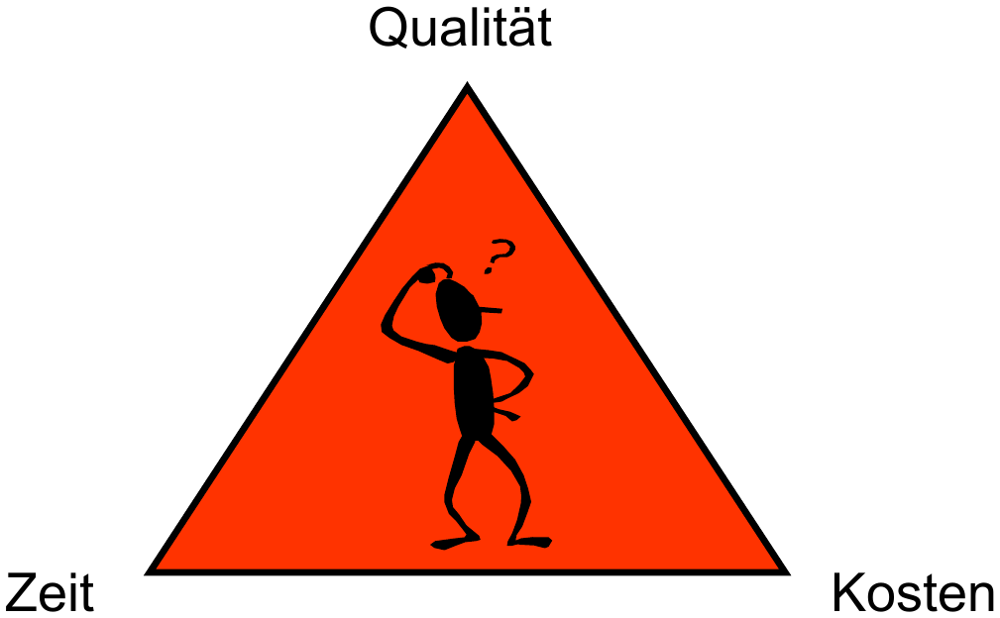

# Was ist Software-Technik?

Zielorientierte Bereitstellung und systematische Verwendung von Prinzipien, Methoden und Werkzeugen für die arbeitsteilige, ingenieurmäßige Entwicklung und Anwendung von umfangreichen Softwaresystemen.

## Zielorientiert...

Das Magische Dreieck aus Kosten, Zeit und Qualität...

Quelle: systems-engineering/origin/WDS125 - Systems Engineering (BäM)/05 LE 2_ Softwaretechnik - Ingenieursmäßige Systementwicklung/Folien der Lerneinheit/02.RE-Softwaretechnik.pdf, Folien 2–3
