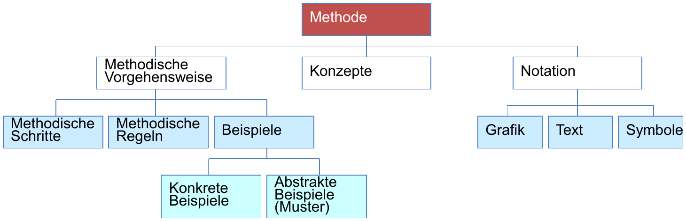

# ...Prinzipien und...

- Prinzipien
  - sind Grundsätze, die man seinem Handeln zugrunde legt
  - sind allgemein gültig, abstrakt und allgemeinster Art
  - bilden eine theoretische Grundlage
  - werden aus Erfahrungen und Erkenntnissen hergeleitet und durch sie bestätigt oder widerlegt
- Prinzip der Abstraktion, Prinzip der Strukturierung, Prinzip der Hierarchisierung, Prinzip der Modularisierung

## ...Methoden anwenden!

- Methoden
  - sind planmäßig angewandte, begründete Vorgehensweisen zur Erreichung von festgelegten Zielen;
  - In der Softwaretechnik wird der Begriff aber auch als Oberbegriff von Konzepten, Notationen und methodischen Vorgehensweisen verstanden.

## Methoden sind Zerlegungsstrategien

Zerlegungsstrategien haben die Aufgabe

- die Komplexität des Systems in kleine handhabbare Teile zu zerlegen, die möglichst stabil sind
  - einfach strukturierte Schnittstellen,
  - nur lokale Auswirkung von Änderungen (Entkopplung; keine Seiteneffekte),
  - pragmatische Zerlegung, die nachvollziehbar ist.

Quelle: systems-engineering/origin/WDS125 - Systems Engineering (BäM)/05 LE 2_ Softwaretechnik - Ingenieursmäßige Systementwicklung/Folien der Lerneinheit/02.RE-Softwaretechnik.pdf, Folien 4–6
