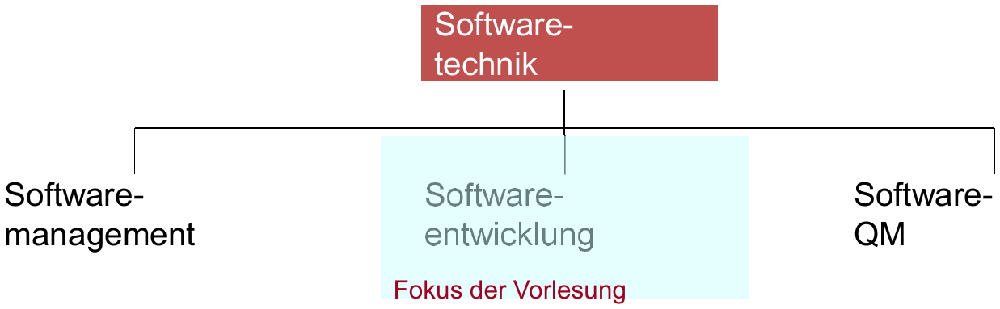
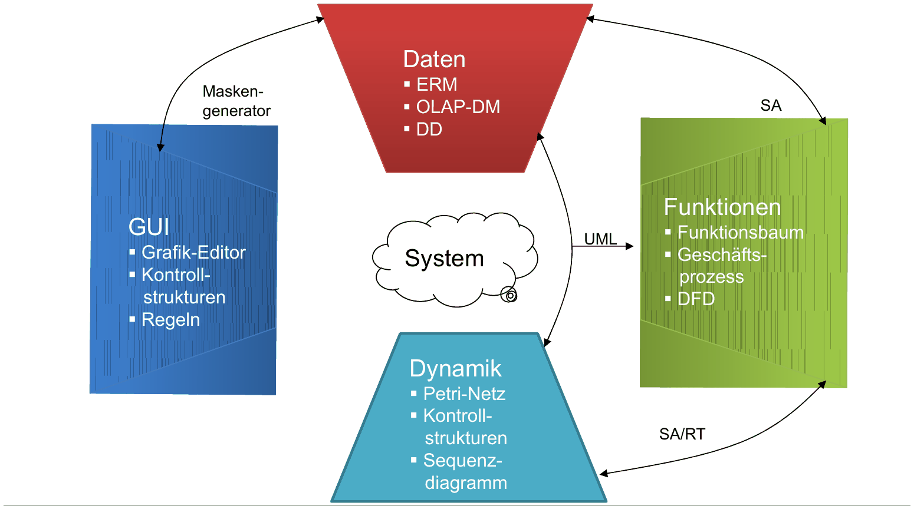

# Teilaufgaben der Softwaretechnik

## Jede Sichtweise führt zu eigenen Modellen

Quelle: systems-engineering/origin/WDS125 - Systems Engineering (BäM)/05 LE 2_ Softwaretechnik - Ingenieursmäßige Systementwicklung/Folien der Lerneinheit/02.RE-Softwaretechnik.pdf, Folien 7–8
