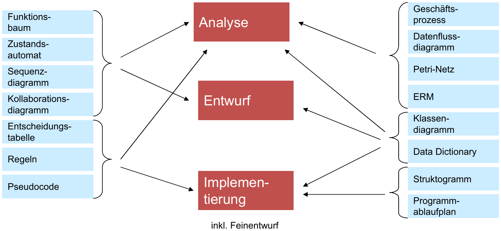

# Komplexitätsarten

- Komplexität der Funktionen
  - Bsp.: Büroanwendungen: ca. 1000-1500 Fkten
- Komplexität der Daten
  - Bsp.: Datenbanksysteme
- Komplexität der Algorithmen
  - Bsp.: komplexe numerische Berechnungen
- Komplexität des zeitabhängigen Verhaltens
  - Bsp.: Betriebssysteme, Prozesssteuerungen
- Komplexität der Systemumgebung (*embedded systems*)
  - Bsp.: Motormanagement, Kraftwerkssteuerungen
- Komplexität der GUI
  - Bsp.: CAD-Systeme, Grafikprogramme

## Basiskonzepte

| Komplexität | Basiskonzepte | Anwendungsbereich |
| --- | --- | --- |
| ...der **Daten** | Data Dictionary ERM (Zustandsautomat) Klassendiagramm | Betriebswirtschaftlich |
| ...der **Funktionen** | Klassendiagramm Geschäftsprozesse Datenflussdiagramm Funktionsbaum | Technisch-wissenschaftlich |
| ...der **Algorithmen** | Pseudocode Programmablaufplan Struktogramm Entscheidungstabelle | Echtzeit |
| ...der **Systemumgebung** | Datenflussdiagramm | |
| ...des **zeitabhängigen Verhaltens** | Petri-Netz Zustandsautomat Aktivitätsdiagramm Sequenzdiagramm Kollaborationsdiagramm | |
| ...der **GUI** | grafische Spezifikation (Petri-Netz) (Zustandsautomat) Kontrollstrukturen | Mensch-Computer-Interaktion |

## Einsatz der Basismethoden in Prozessmodellen

Quelle: systems-engineering/origin/WDS125 - Systems Engineering (BäM)/05 LE 2_ Softwaretechnik - Ingenieursmäßige Systementwicklung/Folien der Lerneinheit/02.RE-Softwaretechnik.pdf, Folien 9–11
