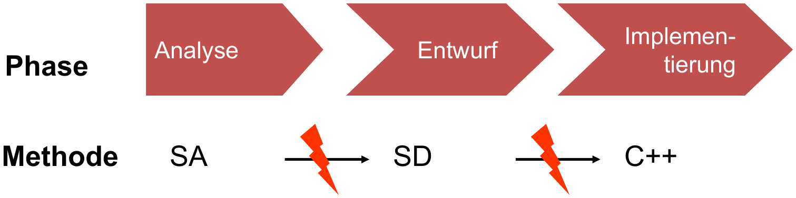

# Unsicherheit über den Wert

Lohnt sich der Aufwand, eine bestimmte Methode zu lernen?

Unterstützt die Methode die Problemlösung?

Wie kann man Methoden vergleichen

- Handhabbarkeit
- Anwendungsbreite
- Erlernbarkeit
- Formalisierungsgrad
- Werkzeugunterstützung
- Unterstützung der Softwaretechnik (Prinzipien etc.)
- Dokumentierbarkeit
- etc.

## Semantische Lücke

Kann die Methode den *semantic gap* überwinden?

Bsp: SA eignet sich gut für die Systemanalyse, ist aber für den Systementwurf nicht einsetzbar.

## 10 Forderungen

- Beitrag zur Lösung des magischen Dreiecks.
- Methodenverbund muss möglich sein.
- Methode muss mindestens für eine Softwareklasse einsetzbar sein.
- Gesicherte theoretische Erkenntnisse als Basis.
- Definierte und nachvollziehbare Arbeitsschritte und –ergebnisse.
- Dokumentierbarkeit und Überprüfbarkeit der Ergebnisse.
- Rechnerunterstützung muss möglich sein.
- Einfache erlernbar, lehrbar und praktizierbar.
- Softwaretechnik-Prinzipien müssen unterstützt werden.
- Aktive Unterstützung des Entwickler: was soll getan werden, nicht: was soll nicht getan werden/ist verboten.

Quelle: systems-engineering/origin/WDS125 - Systems Engineering (BäM)/05 LE 2_ Softwaretechnik - Ingenieursmäßige Systementwicklung/Folien der Lerneinheit/02.RE-Softwaretechnik.pdf, Folien 12–14
