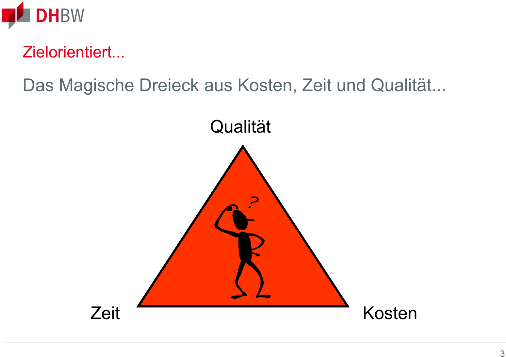
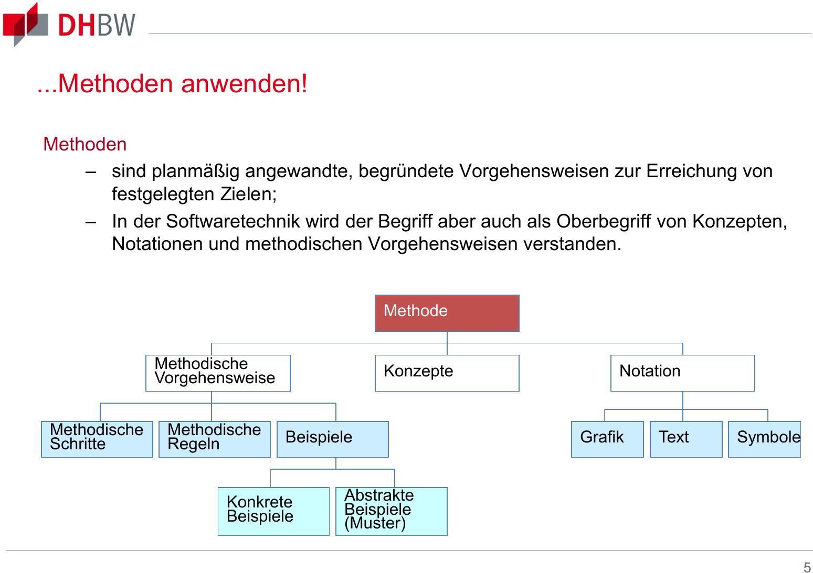
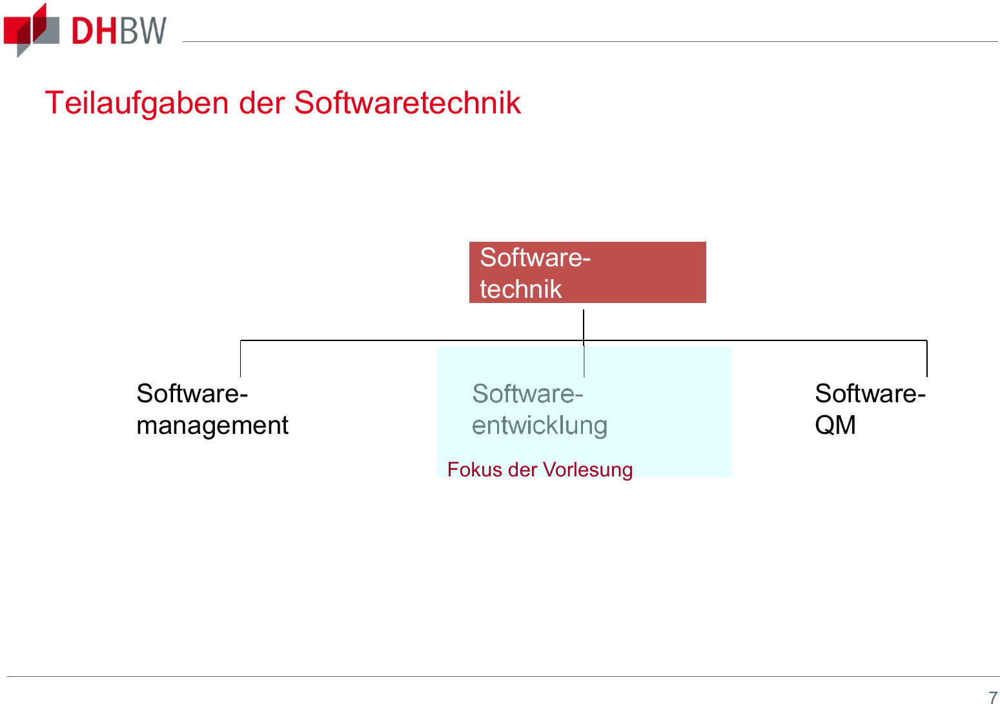
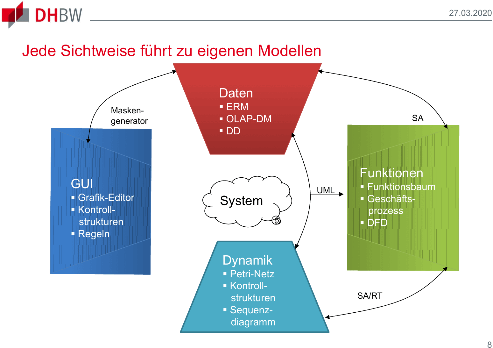
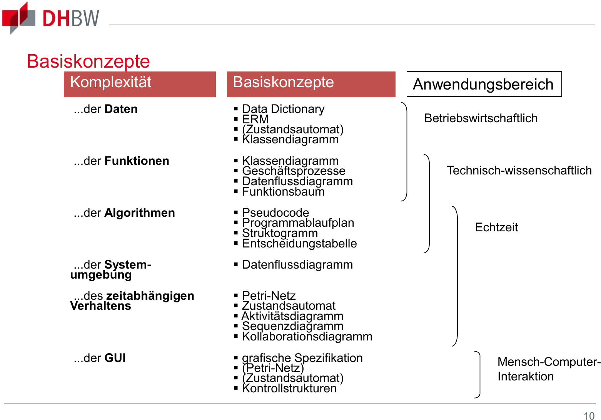
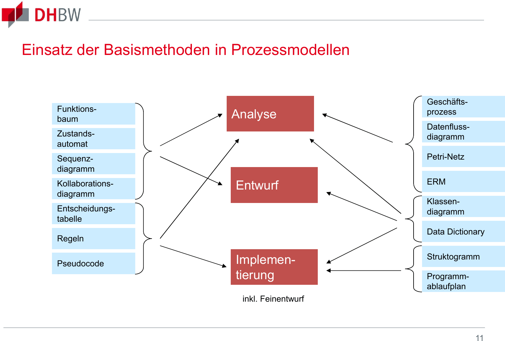
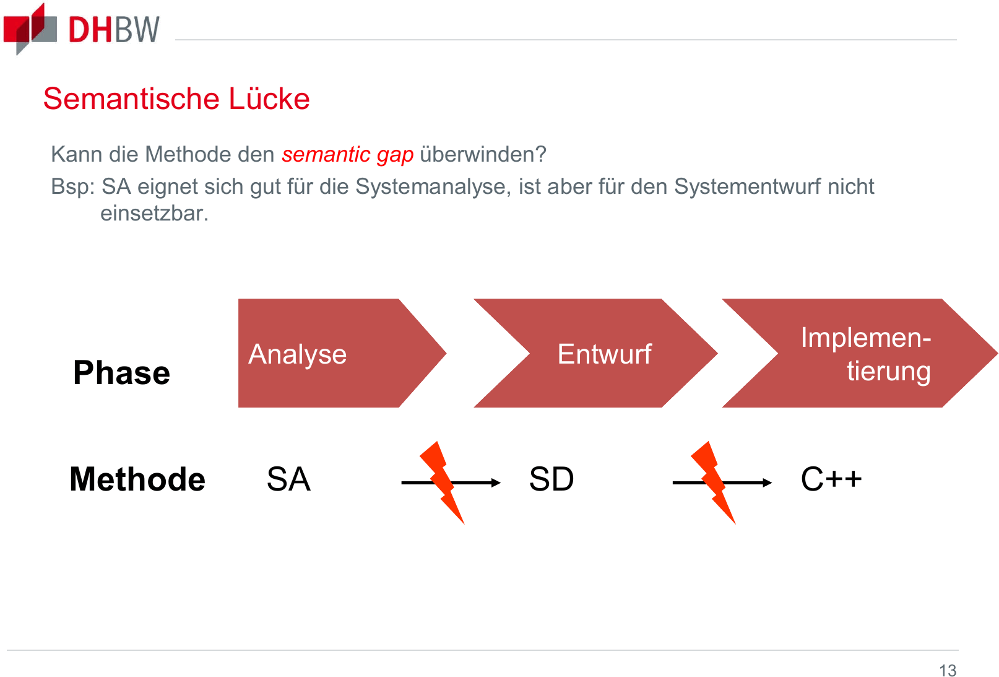

# Sofwaretechnik (engl. Software Engineering)

## Was ist Software-Technik?

Zielorientierte Bereitstellung und systematische Verwendung von Prinzipien, Methoden und Werkzeugen für die arbeitsteilige, ingenieurmäßige Entwicklung und Anwendung von umfangreichen Softwaresystemen.

## Zielorientiert...

Das Magische Dreieck aus Kosten, Zeit und Qualität...

## ...Prinzipien und...

- Prinzipien
  - sind Grundsätze, die man seinem Handeln zugrunde legt
  - sind allgemein gültig, abstrakt und allgemeinster Art
  - bilden eine theoretische Grundlage
  - werden aus Erfahrungen und Erkenntnissen hergeleitet und durch sie bestätigt oder widerlegt
- Prinzip der Abstraktion, Prinzip der Strukturierung, Prinzip der Hierarchisierung, Prinzip der Modularisierung

## ...Methoden anwenden!

- Methoden
  - sind planmäßig angewandte, begründete Vorgehensweisen zur Erreichung von festgelegten Zielen;
  - In der Softwaretechnik wird der Begriff aber auch als Oberbegriff von Konzepten, Notationen und methodischen Vorgehensweisen verstanden.

## Methoden sind Zerlegungsstrategien

Zerlegungsstrategien haben die Aufgabe

- die Komplexität des Systems in kleine handhabbare Teile zu zerlegen, die möglichst stabil sind
  - einfach strukturierte Schnittstellen,
  - nur lokale Auswirkung von Änderungen (Entkopplung; keine Seiteneffekte),
  - pragmatische Zerlegung, die nachvollziehbar ist.

## Teilaufgaben der Softwaretechnik

## Jede Sichtweise führt zu eigenen Modellen

## Komplexitätsarten

- Komplexität der Funktionen
  - Bsp.: Büroanwendungen: ca. 1000-1500 Fkten
- Komplexität der Daten
  - Bsp.: Datenbanksysteme
- Komplexität der Algorithmen
  - Bsp.: komplexe numerische Berechnungen
- Komplexität des zeitabhängigen Verhaltens
  - Bsp.: Betriebssysteme, Prozesssteuerungen
- Komplexität der Systemumgebung (*embedded systems*)
  - Bsp.: Motormanagement, Kraftwerkssteuerungen
- Komplexität der GUI
  - Bsp.: CAD-Systeme, Grafikprogramme

## Basiskonzepte

| Komplexität | Basiskonzepte | Anwendungsbereich |
| --- | --- | --- |
| ...der **Daten** | Data Dictionary ERM (Zustandsautomat) Klassendiagramm | Betriebswirtschaftlich |
| ...der **Funktionen** | Klassendiagramm Geschäftsprozesse Datenflussdiagramm Funktionsbaum | Technisch-wissenschaftlich |
| ...der **Algorithmen** | Pseudocode Programmablaufplan Struktogramm Entscheidungstabelle | Echtzeit |
| ...der **Systemumgebung** | Datenflussdiagramm | |
| ...des **zeitabhängigen Verhaltens** | Petri-Netz Zustandsautomat Aktivitätsdiagramm Sequenzdiagramm Kollaborationsdiagramm | |
| ...der **GUI** | grafische Spezifikation (Petri-Netz) (Zustandsautomat) Kontrollstrukturen | Mensch-Computer-Interaktion |

## Einsatz der Basismethoden in Prozessmodellen

## Unsicherheit über den Wert

Lohnt sich der Aufwand, eine bestimmte Methode zu lernen?

Unterstützt die Methode die Problemlösung?

Wie kann man Methoden vergleichen

- Handhabbarkeit
- Anwendungsbreite
- Erlernbarkeit
- Formalisierungsgrad
- Werkzeugunterstützung
- Unterstützung der Softwaretechnik (Prinzipien etc.)
- Dokumentierbarkeit
- etc.

## Semantische Lücke

Kann die Methode den *semantic gap* überwinden?

Bsp: SA eignet sich gut für die Systemanalyse, ist aber für den Systementwurf nicht einsetzbar.

## 10 Forderungen

- Beitrag zur Lösung des magischen Dreiecks.
- Methodenverbund muss möglich sein.
- Methode muss mindestens für eine Softwareklasse einsetzbar sein.
- Gesicherte theoretische Erkenntnisse als Basis.
- Definierte und nachvollziehbare Arbeitsschritte und –ergebnisse.
- Dokumentierbarkeit und Überprüfbarkeit der Ergebnisse.
- Rechnerunterstützung muss möglich sein.
- Einfache erlernbar, lehrbar und praktizierbar.
- Softwaretechnik-Prinzipien müssen unterstützt werden.
- Aktive Unterstützung des Entwickler: was soll getan werden, nicht: was soll nicht getan werden/ist verboten.

Quelle: systems-engineering/origin/WDS125 - Systems Engineering (BäM)/05 LE 2_ Softwaretechnik - Ingenieursmäßige Systementwicklung/Folien der Lerneinheit/02.RE-Softwaretechnik.pdf, Seiten 1–14
