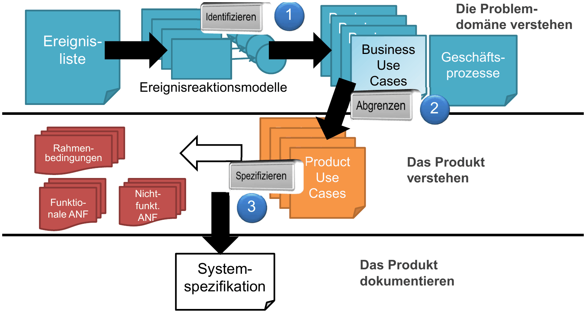

# So werden wir vorgehen - Das RE-Vorgehensmodell

## Zwei Spezifikationsdokumente entstehen im RE

**Lastenheft**

- Das Lastenheft enthält eine Zusammenfassung aller Benutzeranforderungen die das System aus Sicht des Auftraggebers erfüllen muss.
- Kann als Ausschreibungsunterlage dienen.
- Zeitpunkt: Projektinitiierungsphase.

**Pflichtenheft**

- Das Pflichtenheft enthält eine detaillierte Darstellung aller Systemanforderungen, die das System aus Sicht des Auftraggebers erfüllen muss.
- Kann als Vertragsgrundlage dienen.
- Zeitpunkt: Analysephase.

Quelle: systems-engineering/origin/WDS125 - Systems Engineering (BäM)/14 Exkurs_ Spezifikationsvorlagen - Inhalte einer Spezifikation/Folien der Lerneinheit/13.RE-Spezifikationsvorlagen.pdf, Folien 2–3
