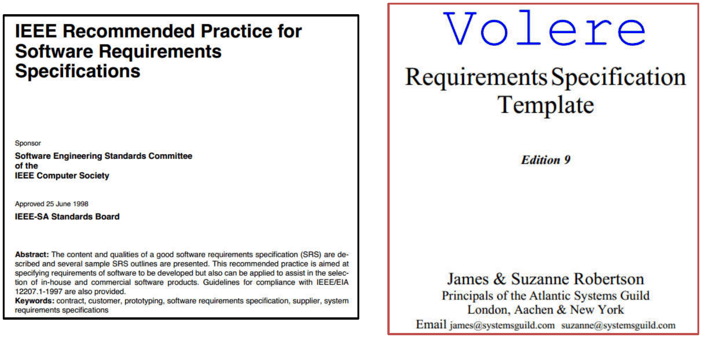

# Es gibt zwei bedeutende Standards als Vorlagen für Spezifikationsdokumente

Quelle: systems-engineering/origin/WDS125 - Systems Engineering (BäM)/14 Exkurs_ Spezifikationsvorlagen - Inhalte einer Spezifikation/Folien der Lerneinheit/13.RE-Spezifikationsvorlagen.pdf, Folie 4
