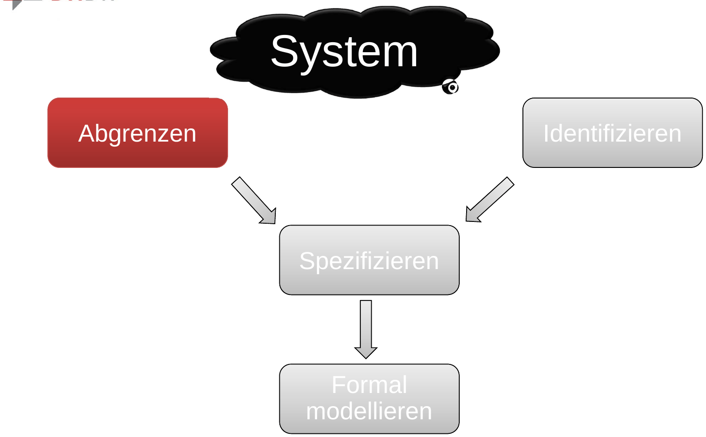
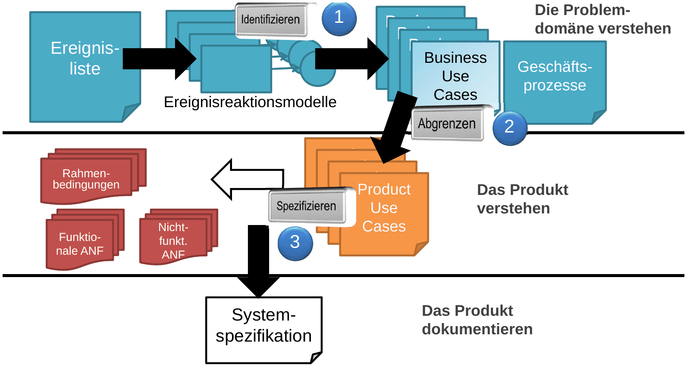

# So werden wir vorgehen - Das RE-Vorgehensmodell

Quelle: systems-engineering/origin/WDS125 - Systems Engineering (BäM)/10 LE 7_ Use Cases - Modellierung der Anwendungsfälle/Folien der Lerneinheit/09.RE-UC.pdf, Folien 2–3
