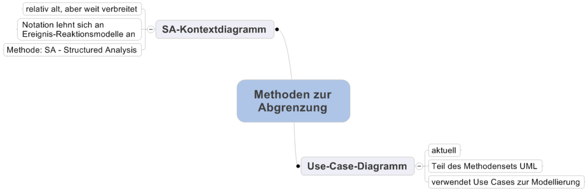
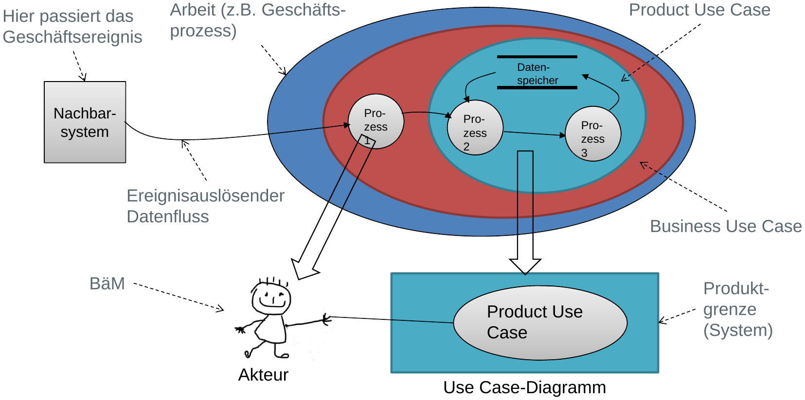

# Es gibt zwei Möglichkeiten der Abgrenzung

- Methoden zur Abgrenzung
  - SA-Kontextdiagramm
    - relativ alt, aber weit verbreitet
    - Notation lehnt sich an Ereignis-Reaktionsmodelle an
    - Methode: SA - Structured Analysis
  - Use-Case-Diagramm
    - aktuell
    - Teil des Methodensets UML
    - verwendet Use Cases zur Modellierung

## Grundsätzlich: Was ist ein Use Case?

- Ein Use Case besteht aus mehreren zusammenhängenden Aufgaben, die von einem Akteur durchgeführt werden, um ein Ziel zu erreichen bzw. ein gewünschtes Ergebnis zu erstellen.
- Ein Akteur ist eine Rolle, die ein Benutzer des Systems einnimmt. Jeder Akteur hat einen gewissen Einfluss auf das System.
- Ein Akteur ist häufig eine Person. Es kann sich aber ebenso um eine Organisationseinheit oder ein externes System handeln, das mit dem zu modellierenden System kommuniziert.
- Akteure befinden sich stets außerhalb des Systems!

## Abgrenzung mittels Business Use Case und Product Use Case

Quelle: systems-engineering/origin/WDS125 - Systems Engineering (BäM)/10 LE 7_ Use Cases - Modellierung der Anwendungsfälle/Folien der Lerneinheit/09.RE-UC.pdf, Folien 4–6
