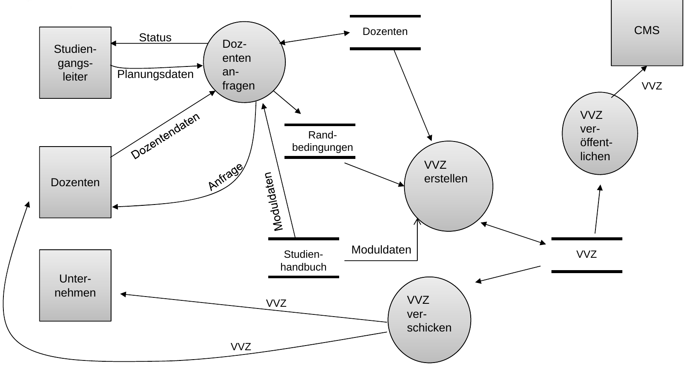
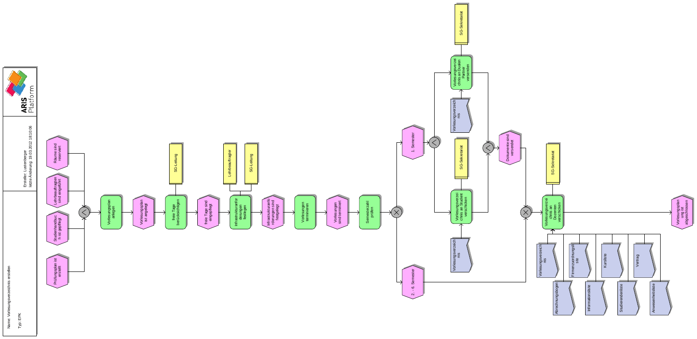
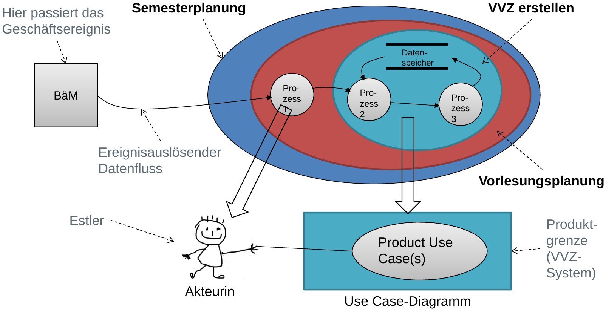

# Fallbeispiel: Vorlesungsplanung (echt pippi…)

Der Studiengangsleiter gibt die zentralen Planungsdaten, wie Kurs, Semester, Dozenten, des Semesters, wichtige Restriktionen (z.B. Sporttag der STUV, Erstsemesterbegrüßung durch Rektor etc.) an die Vorlesungsplanerin, Frau Estler. Dies erfolgt in einem sogenannten Kick-Off-Meeting ca. 4 Monate vor Semesterstart. Die Vorlesungsplanerin notiert sich diese Randbedingungen, insoweit sie sie sowieso nicht schon schriftlich vom Studiengangsleiter bekommt. Bei diesem Meeting wird auch anhand des Studienhandbuchs festgelegt, welche Module mit welchen Vorlesungen in welchem Zeitumfang mit welchen Inhalten zu planen sind. Dann beginnt Frau Estler mit der Anfrage der Dozenten: Sie ruft an, mailt oder spricht Dozenten direkt an, wenn sie im Studiengang sind. Dazu kann sie auch auf die Datenbank "Dozentenpool" zugreifen, in der alle Kontaktdaten gespeichert sind. Nach Kontaktaufnahme mit einem Dozenten frägt die Vorlesungsplanerin die Dozentendaten ab, wie Termine, Raum- und Materialbedarf. Das alles muss für die weitere Planung schriftlich festgehalten werden, damit alles im Semester passt. Außerdem ist immer der Studiengangsleiter regelmäßig zu informieren. Liegen alle Dozentendaten vor und gibt es keine Terminkonflikte oder anderen Planungsprobleme mehr, wird das VVZ erstellt. Danach wird es ausgedruckt und an Dozenten und Unternehmen per Post verschickt. Für die Studierenden wird ein PDF-Dokument des VVZ auf der Webseite des Studiengangs eingestellt.

## Abgrenzung mittels Business Use Case und Product Use Case

Quelle: systems-engineering/origin/WDS125 - Systems Engineering (BäM)/10 LE 7_ Use Cases - Modellierung der Anwendungsfälle/Folien der Lerneinheit/09.RE-UC.pdf, Folien 7–10
