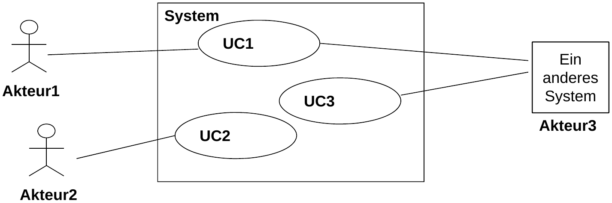
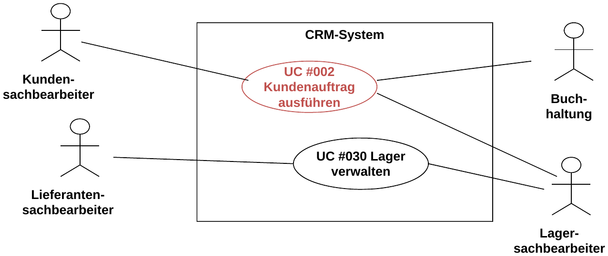

# Abgrenzung: UC-Diagramm

- Das Zusammenspiel mehrerer Product Use Cases untereinander und mit den Akteuren wird im Use Case-Diagramm (use case diagramm) modelliert.
- Es gibt auf hohem Abstraktionsniveau einen guten Überblick über das System und seine Schnittstellen zur Umwelt.
- Die Akteure werden als Strichmännchen eingezeichnet. Externe Systeme können auch als Rechtecke dargestellt werden.
- Use Cases sind immer Ovale.
- Eine Linie zwischen Akteuren und Use Cases bedeutet, dass eine Kommunikation stattfindet.
- Das System wird als Rechteck gezeichnet.
- Das UC-Diagramm fasst die Product Use Cases visuell zusammen. Es zeigt also, welche Business Use Cases durch das System realisiert werden sollen.

## UC-Diagramm: Modellnotation

## In unserem Beispiel könnte das so aussehen…

…wird es aber nicht, denn es geht genauer…

Quelle: systems-engineering/origin/WDS125 - Systems Engineering (BäM)/10 LE 7_ Use Cases - Modellierung der Anwendungsfälle/Folien der Lerneinheit/09.RE-UC.pdf, Folien 15–17
