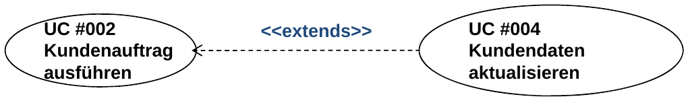
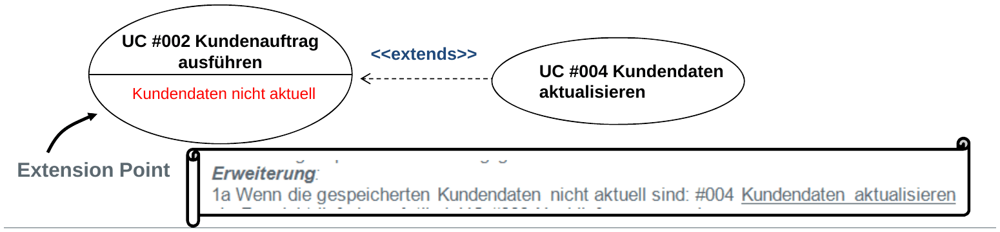
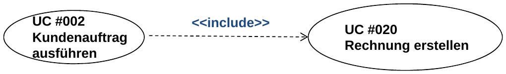
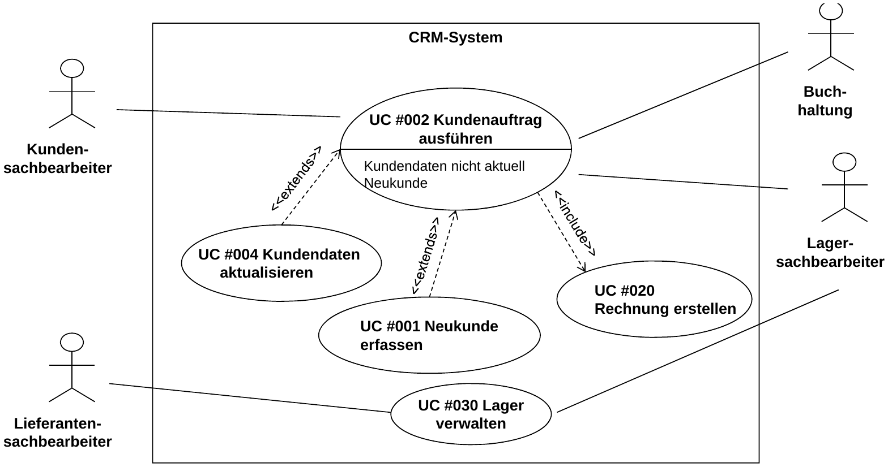
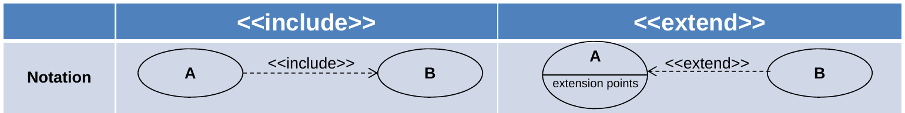

# Beziehungen zwischen Uses Cases

Zwischen Use Cases können zwei Arten von Beziehungen bestehen:

- Eine extends-Beziehung liegt vor, wenn ein Use Case B ähnlich einem Use Case A ist, aber „etwas mehr als A tut“. Die extends-Beziehung ermöglicht es, einen komplexen Use Case zunächst in vereinfachter Form zu spezifizieren und komplexe Sonderfälle in die Erweiterungen auszulagern.
- Eine include-Beziehung liegt vor, wenn zwei Use Cases A und B ein gemeinsames Verhalten besitzen, das in dem Use Case C spezifiziert ist. Der Use Case C wird analog zu einem Unterprogramm aufgerufen bzw. benutzt.

## Spezialfall der Kundendatenaktualisierung: `<<extend>>`

UC "Kundenauftrag ausführen" wird – unter bestimmten Bedingungen – durch den UC "Kundendaten aktualisieren" erweitert.

Die Bedingung wird als "Extension Point bezeichnet und kann wie folgt dargestellt werden:

## Inkludierung der Rechnungsstellung: `<<include>>`

UC #002 "Kundenauftrag ausführen" inkludiert immer den UC #020 "Rechnung erstellen"

## Einbau in unser UC-Diagramm

## Notation

|  | `<<include>>` | `<<extend>>` |
| --- | --- | --- |
| **Bedeutung** | Ablauf von A schließt immer Ablauf von B ein | Ablauf von A kann, muss aber nicht durch den Ablauf von B erweitert werden |
| **Wann genutzt?** | Ablauf von B kann in verschiedenen UC genutzt werden | A besitzt neben Normalverhalten einen in B ausgelagerten Sonderfall |
| **Bedeutung für einen UC** | A ist meist unvollständig und wird erst durch Inklusion von B zu einem vollständigen Ablauf | A ist meist vollständig und kann durch B optional erweitert werden |
| **Abhängigkeiten** | A muss B bei der Modellierung berücksichtigen  B wird unabhängig von A modelliert, um die Nutzung durch weitere UC sicherzustellen (Wiederverwendbarkeit). B muss in sich nicht vollständig sein ("B weiß nicht, durch wen er inkludiert wird") | A muss durch Angabe von Erweiterungspunkten auf B vorbereitet werden  B wird in sich vollständig und unabhängig von A modelliert ("B weiß nicht, wen er erweitert") |

Quelle: systems-engineering/origin/WDS125 - Systems Engineering (BäM)/10 LE 7_ Use Cases - Modellierung der Anwendungsfälle/Folien der Lerneinheit/09.RE-UC.pdf, Folien 18–22
