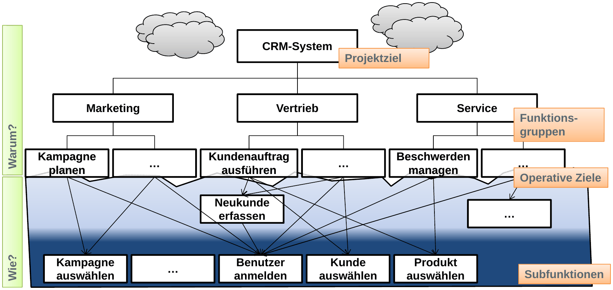

# Zwei typische und wichtige Fragen bei der Modellierung von Use Cases…

- **Wie detailliert muss ein Use Case sein?**
  - man kann Use Cases sehr global und allgemein beschreiben
  - man kann sie aber auch sehr detailliert ausformulieren
- **Wie formuliert man einen guten Use Case?**
  - man kann Use Cases sprachlich kompakt formulieren
  - man kann sie aber auch sehr ausführlich und detailliert formulieren

## Wie detailliert muss ein Use Case sein? Keine leichte Frage…

## Ausgangspunkt ist das Geschäftsziel des Akteurs

> **Merke:**
>
> 1. Ausgangspunkt sind die Use Cases der operativen Ziele!
> 2. Die Abgrenzung der Use Cases ist nie eindeutig richtig, kann aber sehr wohl eindeutig falsch sein!
> 3. Ein Use Case für operative Ziele muss den *coffee break test* aus Sicht des Akteurs bestehen: "After I get done with this, I can take a coffee break!"
> 4. Typischerweise dauert diese Aktivität 2-20 min und betrifft 1 Person und wird in 1 Sitzung erledigt

Sich 30 mal anzumelden ist kein operatives Ziel.
Einen Neukunden erfassen hingegen schon.

Eine Kampagne auszuwählen ist kein operatives Ziel.
Eine Kampagne planen hingegen schon.

Quelle: systems-engineering/origin/WDS125 - Systems Engineering (BäM)/10 LE 7_ Use Cases - Modellierung der Anwendungsfälle/Folien der Lerneinheit/09.RE-UC.pdf, Folien 23–25
