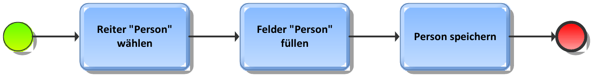

# Wie formuliert man einen guten Use Case? Auch keine leichte Frage…

…so sicher nicht!

## R1: Einfache Grammatik

> Subjekt … Verb … Objekt … Präpositionalphrase

> Der Bankkunde hebt den Geldbetrag von seinem Bankkonto ab.

## R2: Es muss klar sein, wer etwas macht – "Who has the ball?"

> Er hebt den Geldbetrag von seinem Bankkonto ab.

> Der Bankkunde hebt den Geldbetrag von seinem Bankkonto ab.

## R3: Aus der Perspektive des Akteurs schreiben

> 1. Authentifizierungsdaten lesen.
> 2. Authentifizierungsdaten prüfen.
> 3. Zahle Geld von Bankkonto an Kunden aus.

> 1. Der Kunde authentifiziert sich gegenüber dem System.
> 2. Der Kunde hebt den Geldbetrag von seinem Bankkonto ab.

## R4: Eine Aktivität sollte einen signifikanten Zwischenerfolg für den Akteur liefern.

Daumenregel: mehr als ca. 9-10 Aktivitäten hat kein guter Use Case!

> Zwischenerfolg kann durch folgende Frage ermittelt werden:
> Warum macht der Akteur das?

> 1. Vornamen eingeben.
> 2. Nachnamen eingeben.
> 3. Kontonummer eingeben.

> 1. Kunde gibt Vor- und Nachnamen sowie Kontonummer für seine Authentifizierung an.

## R5: Die Absicht des Akteurs sollte in der Aktivitätsformulierung erkennbar werden.

> 1. System erfragt Vornamen.
> 2. Kunde gibt Vornamen an.
> 3. System erfragt Nachnamen.
> 4. Kunde gibt Nachnamen an.
> 5. System erfragt Kontonummer.
> 6. Kunde gibt Kontonummer an.
> 7. System prüft Authentifizierung.

> 1. Der Kunde gibt Vor- und Nachnamen sowie Kontonummer für seine Authentifizierung an.
> 2. Das System validiert den Kunden anhand seiner Authentifizierungsdaten.

## R6: Ereignis-Reaktionsschema vollständig beschreiben

1. Der Akteur sendet Daten als auslösendes Ereignis.
2. Das System überprüft die Daten.
3. Das System reagiert auf die Daten.
4. Das System gibt das Ergebnis der Reaktion an den Akteur.

## R7: Validieren statt überprüfen

WOZU wird etwas gemacht, nicht einfach: ETWAS wird gemacht.
„Prüfen“, „überprüfen“ führt fast immer zur Notwendigkeit einer Folgeaktivität mit Anfangsbedingung „Wenn korrekt, dann…“

> 1. Das System überprüft die Authentifizierungsdaten.
> 2. Wenn korrekt authentifiziert, bekommt der Kunde die Serviceauswahl vom System angeboten.
>
> Alternative:
> 2a. Wenn nicht korrekt authentifiziert: Den Kunden darüber informieren und abbrechen.

> 1. Das System validiert den Kunden anhand seiner Authentifizierungsdaten.
> 2. Der Kunde bekommt die Serviceauswahl vom System angeboten.
>
> Alternative:
> 2a. Wenn nicht korrekt authentifiziert: Den Kunden über fehlgeschlagene Validierung informieren und abbrechen.

## R8: Wiederholungen

> Wiederhole — Aktivität x-y — Endebedingung

> 1. Der Kunde wählt eine zu kaufende Aktie anhand ihrer Wertpapiernummer aus.
> 2. Der Kunde gibt die zu kaufende Stückzahl der ausgewählten Aktie sowie den Börsenplatz für den Kauf an.
>    Wiederhole Schritt 1 und 2 bis der Kunde alle zu kaufenden Aktien ausgewählt hat.
> 3. Der Kunde bestätigt den Kauf der ausgewählten Aktien.
> 4. Das System kauft die Aktien und bestätigt dem Kunden den Kauf.

## Ein gut formulierter Use Case für UC #001 Neukunde erfassen

1. **Use Case**: #001 Neukunde erfassen.
2. **Ziel**: Ein neuer Kunde wurde erfasst.
3. **Vorbedingung**: es handelt sich um eine natürliche Person (Endkunde) und die Kundenstammdaten liegen vor.
4. **Nachbedingung Erfolg**: Die für Auftragsdurchführung und Kundenkommunikation notwendigen Stammdaten des neuen Kunden wurden erfasst und gespeichert.
5. **Nachbedingung Fehlschlag**: Der Kundenstammdatensatz wurde nicht im CRM-System angelegt. Die Gründe für den Fehlschlag wurden mitgeteilt.
6. **Akteur**: Kundensachbearbeiter.
7. **Auslösendes Ereignis**: Ein Kaufauftrag wurde durch einen Neukunden erteilt.
8. **Beschreibung**:
   1. Der Kundensachbearbeiter validiert die Kundenstammdaten (Vorname, Nachname, Lieferadresse, Rechnungsadresse, Geburtsdatum) auf Plausibilität und Vollständigkeit.
   2. Der Kundensachbearbeiter legt den neuen Kundenstammsatz im CRM-System an.
   3. Das CRM-System generiert die Kundennummer und speichert sie im Kundenstammsatz.

   **Alternativen**:
   - 2a. Die Validierung war nicht erfolgreich: Unter Angabe der Gründe für den Fehlschlag bricht der Kundensachbearbeiter den UC ab.

Quelle: systems-engineering/origin/WDS125 - Systems Engineering (BäM)/10 LE 7_ Use Cases - Modellierung der Anwendungsfälle/Folien der Lerneinheit/09.RE-UC.pdf, Folien 26–35
