# Business Use Cases / Product Use Cases

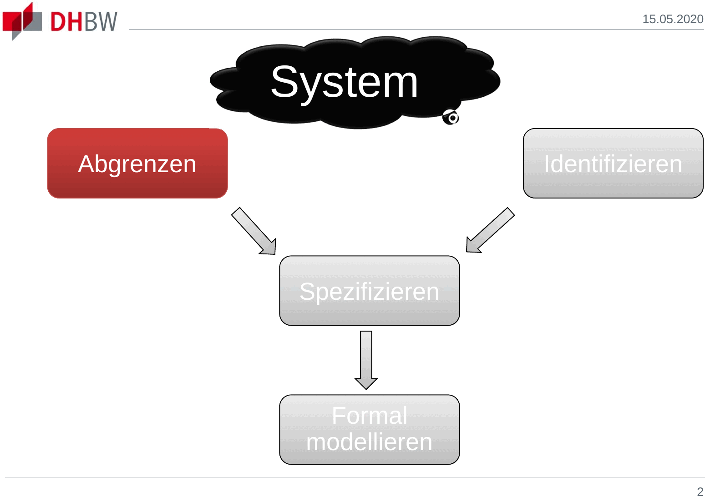

## So werden wir vorgehen - Das RE-Vorgehensmodell

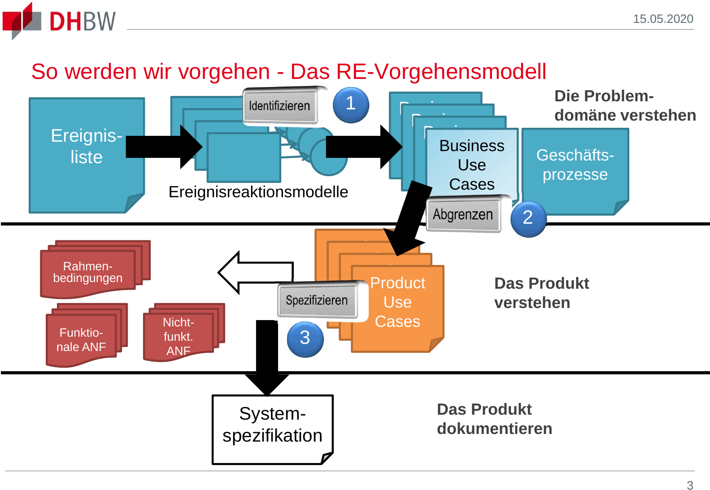

## Es gibt zwei Möglichkeiten der Abgrenzung

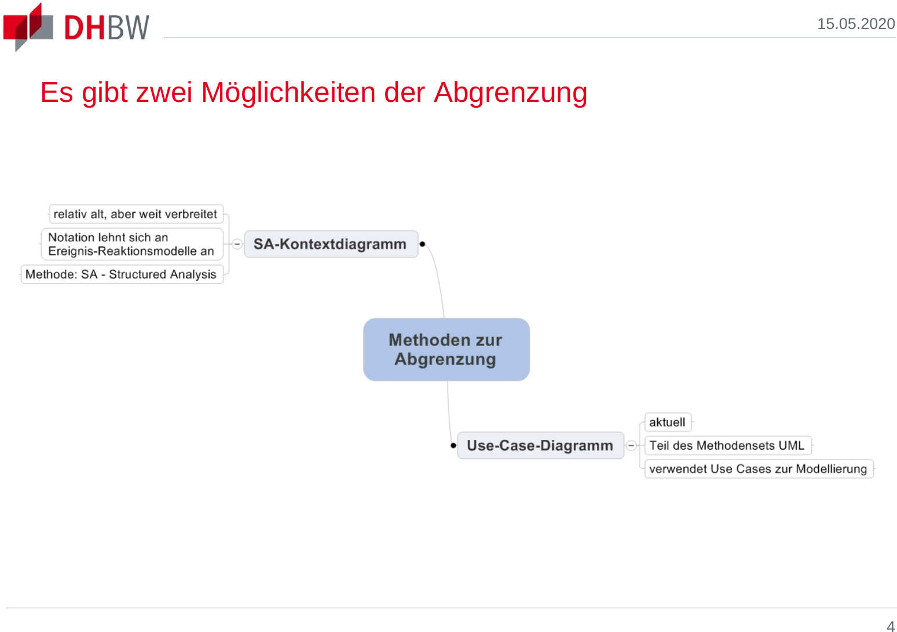

- Methoden zur Abgrenzung
  - SA-Kontextdiagramm
    - relativ alt, aber weit verbreitet
    - Notation lehnt sich an Ereignis-Reaktionsmodelle an
    - Methode: SA - Structured Analysis
  - Use-Case-Diagramm
    - aktuell
    - Teil des Methodensets UML
    - verwendet Use Cases zur Modellierung

## Grundsätzlich: Was ist ein Use Case?

- Ein Use Case besteht aus mehreren zusammenhängenden Aufgaben, die von einem Akteur durchgeführt werden, um ein Ziel zu erreichen bzw. ein gewünschtes Ergebnis zu erstellen.
- Ein Akteur ist eine Rolle, die ein Benutzer des Systems einnimmt. Jeder Akteur hat einen gewissen Einfluss auf das System.
- Ein Akteur ist häufig eine Person. Es kann sich aber ebenso um eine Organisationseinheit oder ein externes System handeln, das mit dem zu modellierenden System kommuniziert.
- Akteure befinden sich stets außerhalb des Systems!

## Abgrenzung mittels Business Use Case und Product Use Case

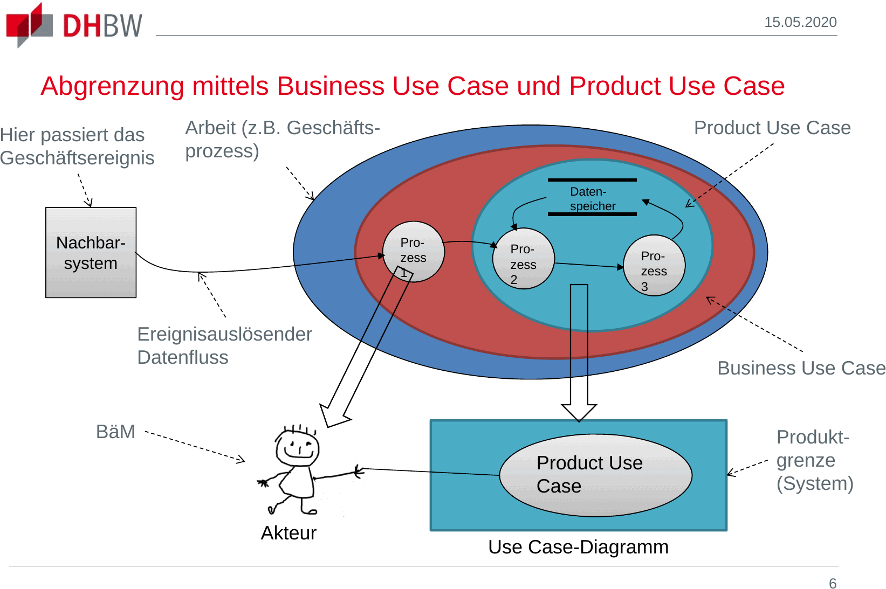

## Fallbeispiel: Vorlesungsplanung (echt pippi…)

Der Studiengangsleiter gibt die zentralen Planungsdaten, wie Kurs, Semester, Dozenten, des Semesters, wichtige Restriktionen (z.B. Sporttag der STUV, Erstsemesterbegrüßung durch Rektor etc.) an die Vorlesungsplanerin, Frau Estler. Dies erfolgt in einem sogenannten Kick-Off-Meeting ca. 4 Monate vor Semesterstart. Die Vorlesungsplanerin notiert sich diese Randbedingungen, insoweit sie sie sowieso nicht schon schriftlich vom Studiengangsleiter bekommt. Bei diesem Meeting wird auch anhand des Studienhandbuchs festgelegt, welche Module mit welchen Vorlesungen in welchem Zeitumfang mit welchen Inhalten zu planen sind. Dann beginnt Frau Estler mit der Anfrage der Dozenten: Sie ruft an, mailt oder spricht Dozenten direkt an, wenn sie im Studiengang sind. Dazu kann sie auch auf die Datenbank "Dozentenpool" zugreifen, in der alle Kontaktdaten gespeichert sind. Nach Kontaktaufnahme mit einem Dozenten frägt die Vorlesungsplanerin die Dozentendaten ab, wie Termine, Raum- und Materialbedarf. Das alles muss für die weitere Planung schriftlich festgehalten werden, damit alles im Semester passt. Außerdem ist immer der Studiengangsleiter regelmäßig zu informieren. Liegen alle Dozentendaten vor und gibt es keine Terminkonflikte oder anderen Planungsprobleme mehr, wird das VVZ erstellt. Danach wird es ausgedruckt und an Dozenten und Unternehmen per Post verschickt. Für die Studierenden wird ein PDF-Dokument des VVZ auf der Webseite des Studiengangs eingestellt.

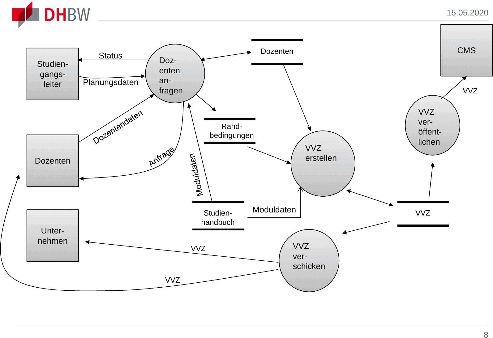

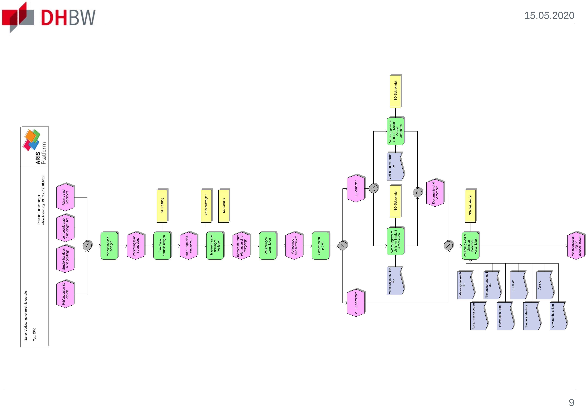

## Abgrenzung mittels Business Use Case und Product Use Case

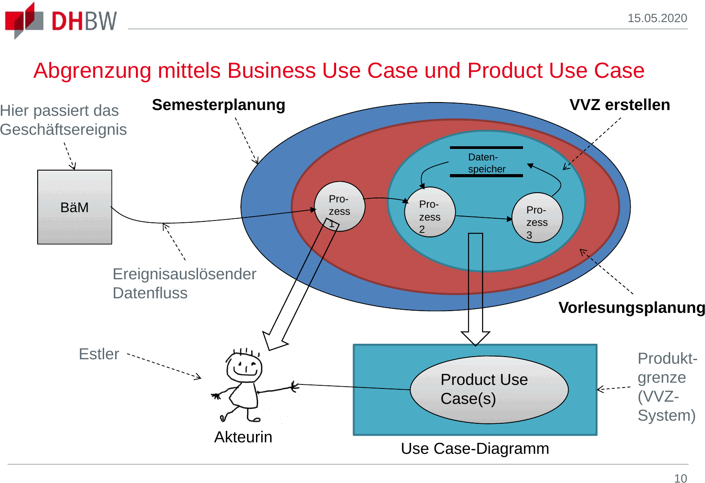

## Notationsformen für Use Cases

- Bei einfachen Use Cases reicht eine umgangssprachliche Beschreibung aus.
- Bei komplexen Use Cases kann eine Use Case-Schablone (use case template) verwendet werden.

## Use Case-Schablone

1. **Use Case**: Name, bestehend aus zwei oder drei Wörtern (was wird getan?)
2. **Ziel**: globale Zielsetzung bei erfolgreicher Ausführung des Use Case
3. **Vorbedingung**: Erwarteter Zustand, vor Beginn
4. **Nachbedingung Erfolg**: Erwarteter Zustand nach erfolgreicher Ausführung, d.h. Ergebnis des Geschäftsprozesses
5. **Nachbedingung Fehlschlag**: Erwarteter Zustand, wenn das Ziel nicht erreicht werden kann
6. **Akteure**: Rollen von Personen oder andere Systeme, die den Use Case auslösen oder daran beteiligt sind
7. **Auslösendes Ereignis**: Wenn dieses Ereignis eintritt, dann wird der Use Case initiiert
8. **Beschreibung**:
   - 1 Erste Aktion
   - 2 Zweite Aktion

   **Erweiterungen**:
   - 1a Erweiterung des Funktionsumfangs der erste Aktion

   **Alternativen**:
   - 1a Alternative Ausführung der ersten Aktion
   - 1b Weitere Alternative zur ersten Aktion

## Beispiel für die umgangssprachliche Formulierung: Use Case: Kundenauftrag ausführen

> Use Case: Kundenauftrag ausführen
>
> Eine Kundenbestellung kommt in der Versandabteilung an. Neukunden werden im System registriert und der Versand an diese Kunden erfolgt ausschließlich per Nachnahme oder per Bankeinzug. Für alle lieferbaren Artikel wird die Rechnung erstellt und als Auftrag an das Lager weitergegeben. Sind einige der gewünschten Artikel nicht lieferbar, so wird der Kunde informiert und die Nachlieferung im System vorgemerkt. Alle erstellten Rechnungen werden an die Buchhaltung weitergegeben.
>
> An diesem Use Case sind folgende Akteure beteiligt: Kundensachbearbeiter, Lagersachbearbeiter und Buchhaltung.

## Gleiches Beispiel mit UC-Schablone

- **Use Case**: #002 Kundenauftrag ausführen
- **Ziel**: Ware an Kunden geliefert
- **Vorbedingung**: -
- **Nachbedingung Erfolg**: Ware ausgeliefert (auch Teillieferungen), Rechnungskopie bei Buchhaltung
- **Nachbedingung Fehlschlag**: Kunde wurde mitgeteilt dass nichts lieferbar ist
- **Akteure**: Kundensachbearbeiter, Lagersachbearbeiter, Buchhaltung
- **Auslösendes Ereignis**: Bestellung des Kunden liegt vor

**Beschreibung**:

- 1 Die Kundendaten werden auf Aktualität geprüft
- 2 Lieferbarkeit prüfen
- 3 Rechnung erstellen: UC #020 Rechnung erstellen
- 4 Auftrag vom Lager ausführen lassen
- 5 Rechnungskopie an Buchhaltung geben

**Erweiterung**:

- 1a Wenn die gespeicherten Kundendaten nicht aktuell sind: UC #004 Kundendaten aktualisieren
- 2a Für nachlieferbare Artikel: UC #003 Nachlieferung veranlassen

**Alternativen**:

- 1a Wenn der Besteller noch nicht Kunde ist: UC #001 Neukunde erfassen
- 3a Wenn ein Artikel nicht lieferbar: Kunde mitteilen, dass nicht geliefert werden kann. UC beenden.

## Abgrenzung: UC-Diagramm

- Das Zusammenspiel mehrerer Product Use Cases untereinander und mit den Akteuren wird im Use Case-Diagramm (use case diagramm) modelliert.
- Es gibt auf hohem Abstraktionsniveau einen guten Überblick über das System und seine Schnittstellen zur Umwelt.
- Die Akteure werden als Strichmännchen eingezeichnet. Externe Systeme können auch als Rechtecke dargestellt werden.
- Use Cases sind immer Ovale.
- Eine Linie zwischen Akteuren und Use Cases bedeutet, dass eine Kommunikation stattfindet.
- Das System wird als Rechteck gezeichnet.
- Das UC-Diagramm fasst die Product Use Cases visuell zusammen. Es zeigt also, welche Business Use Cases durch das System realisiert werden sollen.

## UC-Diagramm: Modellnotation

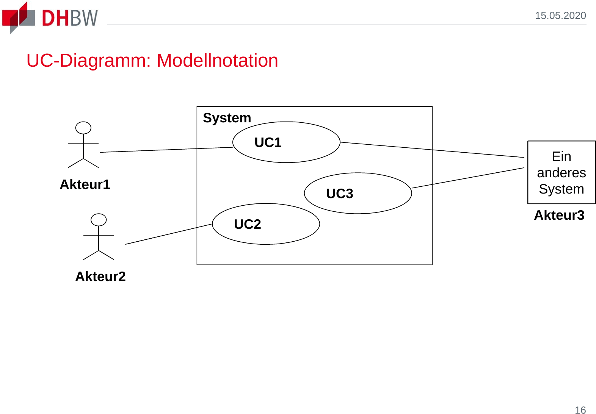

## In unserem Beispiel könnte das so aussehen…

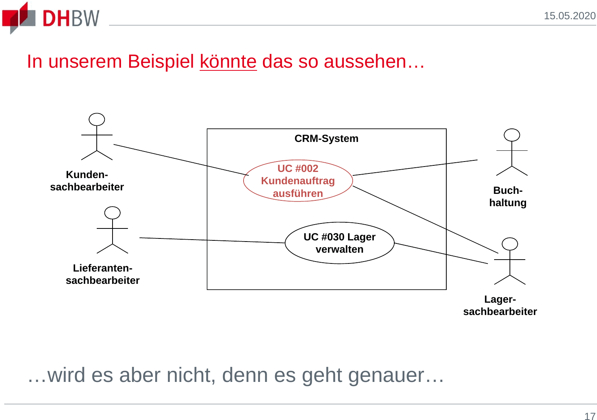

…wird es aber nicht, denn es geht genauer…

## Beziehungen zwischen Uses Cases

Zwischen Use Cases können zwei Arten von Beziehungen bestehen:

- Eine extends-Beziehung liegt vor, wenn ein Use Case B ähnlich einem Use Case A ist, aber „etwas mehr als A tut“. Die extends-Beziehung ermöglicht es, einen komplexen Use Case zunächst in vereinfachter Form zu spezifizieren und komplexe Sonderfälle in die Erweiterungen auszulagern.
- Eine include-Beziehung liegt vor, wenn zwei Use Cases A und B ein gemeinsames Verhalten besitzen, das in dem Use Case C spezifiziert ist. Der Use Case C wird analog zu einem Unterprogramm aufgerufen bzw. benutzt.

## Spezialfall der Kundendatenaktualisierung: `<<extend>>`

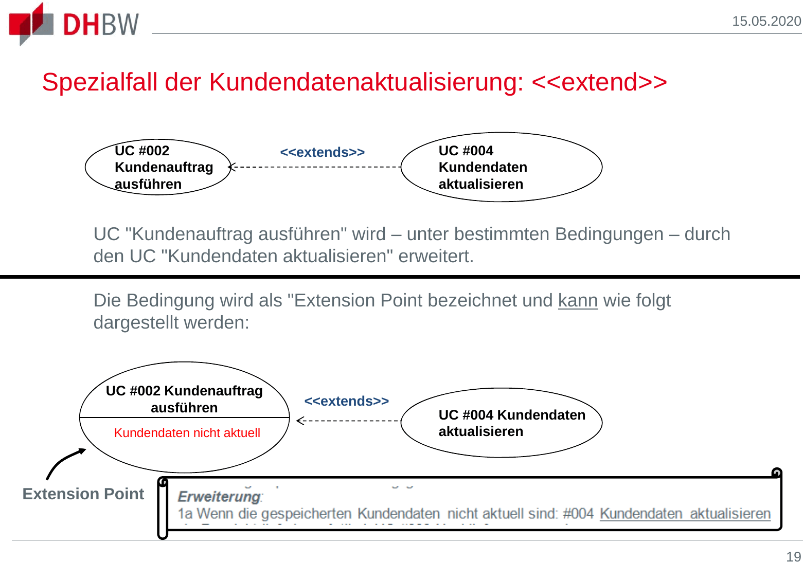

UC "Kundenauftrag ausführen" wird – unter bestimmten Bedingungen – durch den UC "Kundendaten aktualisieren" erweitert.

Die Bedingung wird als "Extension Point bezeichnet und kann wie folgt dargestellt werden:

## Inkludierung der Rechnungsstellung: `<<include>>`

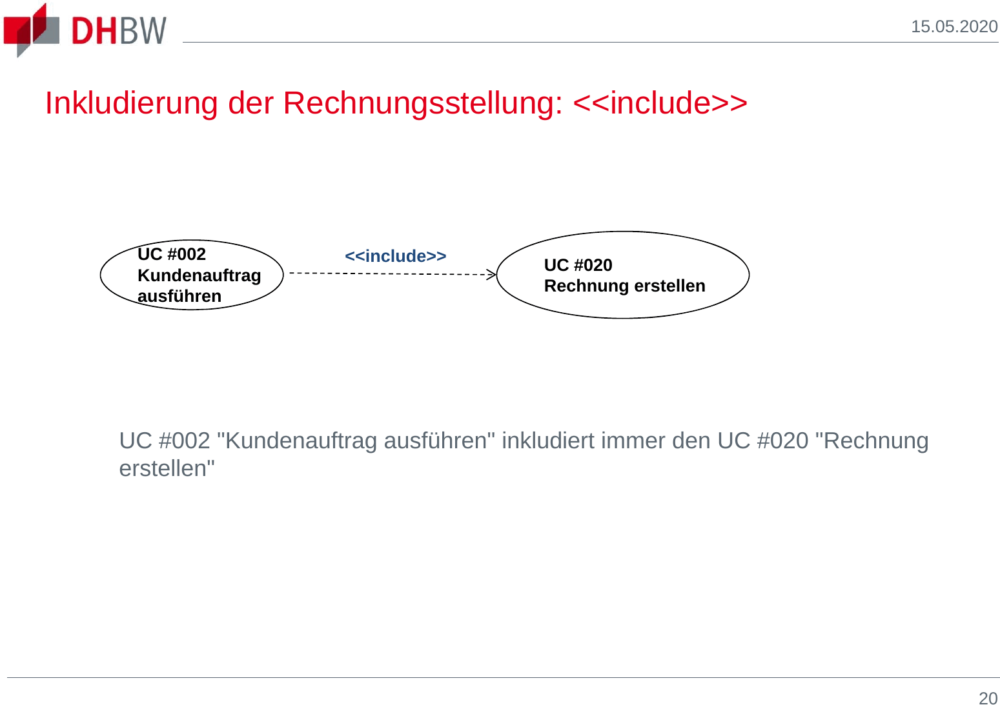

UC #002 "Kundenauftrag ausführen" inkludiert immer den UC #020 "Rechnung erstellen"

## Einbau in unser UC-Diagramm

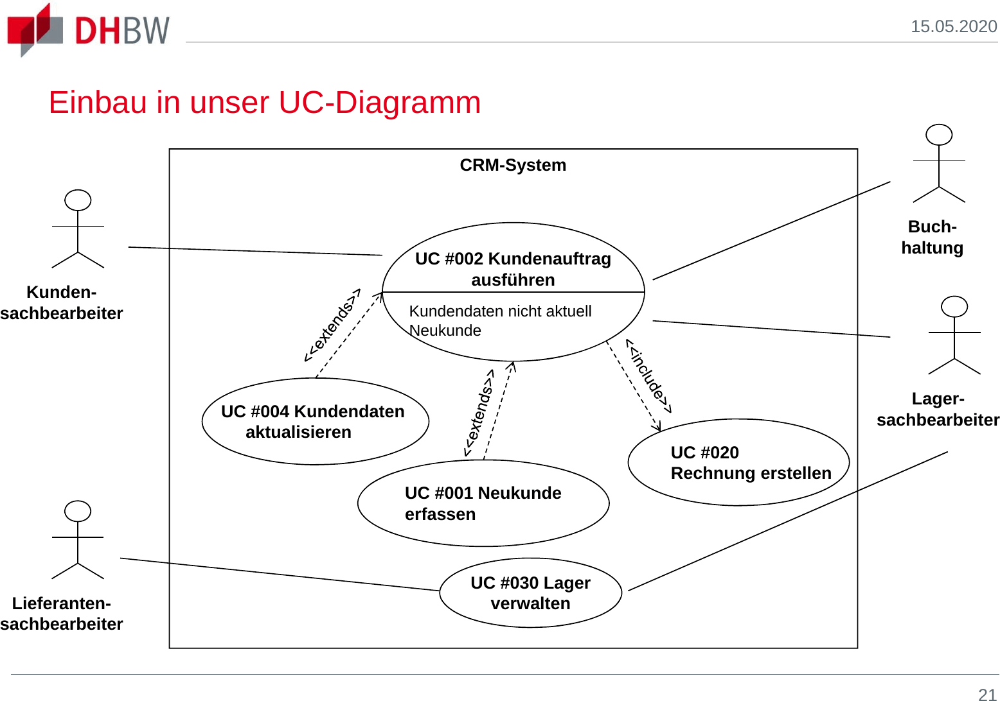

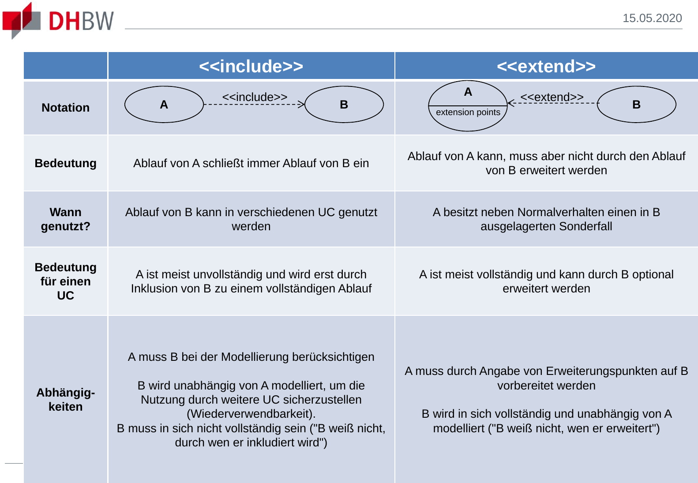

|  | `<<include>>` | `<<extend>>` |
| --- | --- | --- |
| **Bedeutung** | Ablauf von A schließt immer Ablauf von B ein | Ablauf von A kann, muss aber nicht durch den Ablauf von B erweitert werden |
| **Wann genutzt?** | Ablauf von B kann in verschiedenen UC genutzt werden | A besitzt neben Normalverhalten einen in B ausgelagerten Sonderfall |
| **Bedeutung für einen UC** | A ist meist unvollständig und wird erst durch Inklusion von B zu einem vollständigen Ablauf | A ist meist vollständig und kann durch B optional erweitert werden |
| **Abhängigkeiten** | A muss B bei der Modellierung berücksichtigen  B wird unabhängig von A modelliert, um die Nutzung durch weitere UC sicherzustellen (Wiederverwendbarkeit). B muss in sich nicht vollständig sein ("B weiß nicht, durch wen er inkludiert wird") | A muss durch Angabe von Erweiterungspunkten auf B vorbereitet werden  B wird in sich vollständig und unabhängig von A modelliert ("B weiß nicht, wen er erweitert") |

## Zwei typische und wichtige Fragen bei der Modellierung von Use Cases…

- **Wie detailliert muss ein Use Case sein?**
  - man kann Use Cases sehr global und allgemein beschreiben
  - man kann sie aber auch sehr detailliert ausformulieren
- **Wie formuliert man einen guten Use Case?**
  - man kann Use Cases sprachlich kompakt formulieren
  - man kann sie aber auch sehr ausführlich und detailliert formulieren

## Wie detailliert muss ein Use Case sein? Keine leichte Frage…

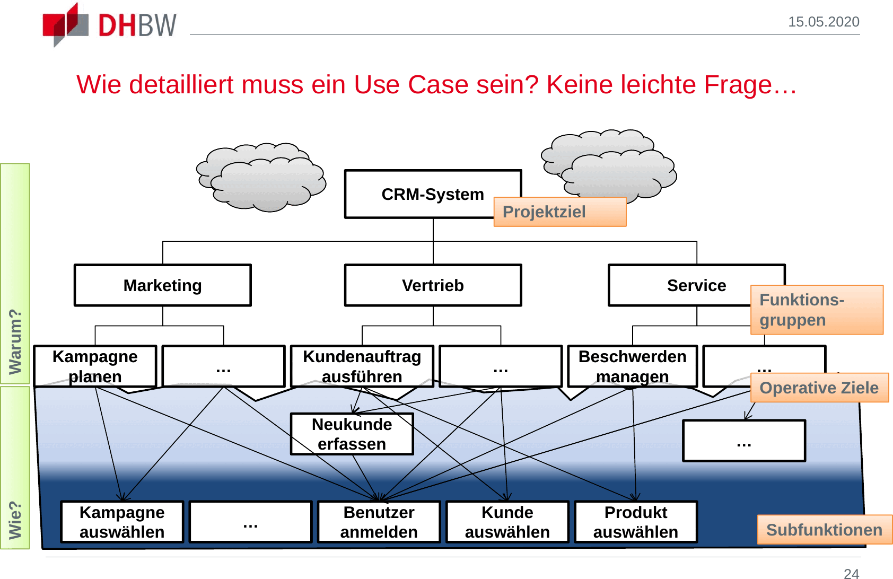

## Ausgangspunkt ist das Geschäftsziel des Akteurs

> **Merke:**
>
> 1. Ausgangspunkt sind die Use Cases der operativen Ziele!
> 2. Die Abgrenzung der Use Cases ist nie eindeutig richtig, kann aber sehr wohl eindeutig falsch sein!
> 3. Ein Use Case für operative Ziele muss den *coffee break test* aus Sicht des Akteurs bestehen: "After I get done with this, I can take a coffee break!"
> 4. Typischerweise dauert diese Aktivität 2-20 min und betrifft 1 Person und wird in 1 Sitzung erledigt

Sich 30 mal anzumelden ist kein operatives Ziel.
Einen Neukunden erfassen hingegen schon.

Eine Kampagne auszuwählen ist kein operatives Ziel.
Eine Kampagne planen hingegen schon.

## Wie formuliert man einen guten Use Case? Auch keine leichte Frage…

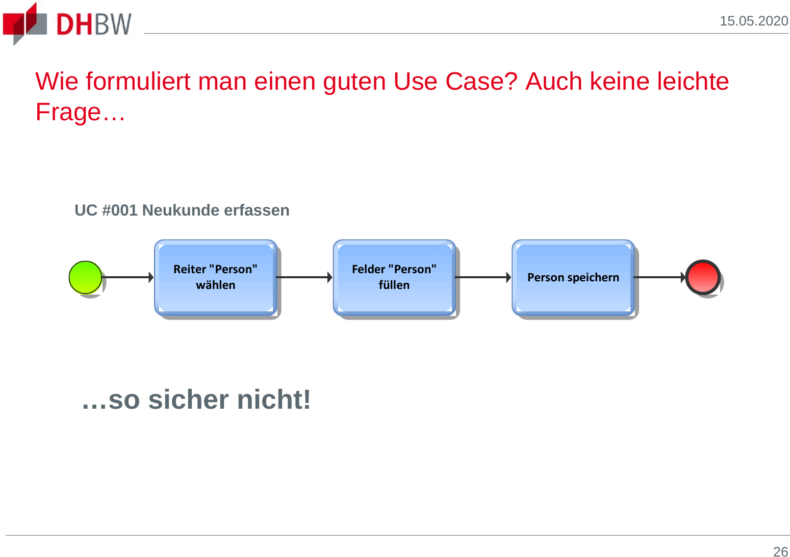

…so sicher nicht!

## R1: Einfache Grammatik

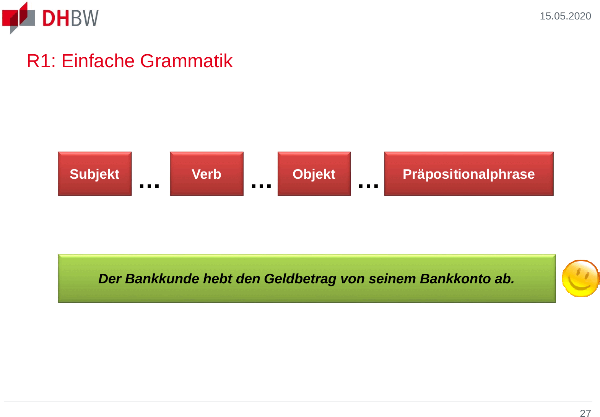

> Subjekt … Verb … Objekt … Präpositionalphrase

> Der Bankkunde hebt den Geldbetrag von seinem Bankkonto ab.

## R2: Es muss klar sein, wer etwas macht – "Who has the ball?"

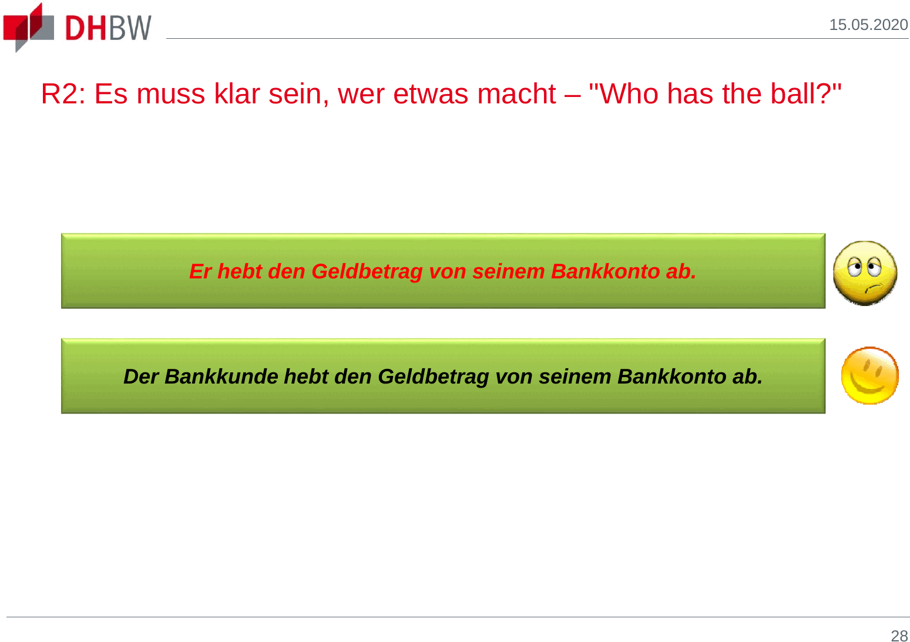

> Er hebt den Geldbetrag von seinem Bankkonto ab.

> Der Bankkunde hebt den Geldbetrag von seinem Bankkonto ab.

## R3: Aus der Perspektive des Akteurs schreiben

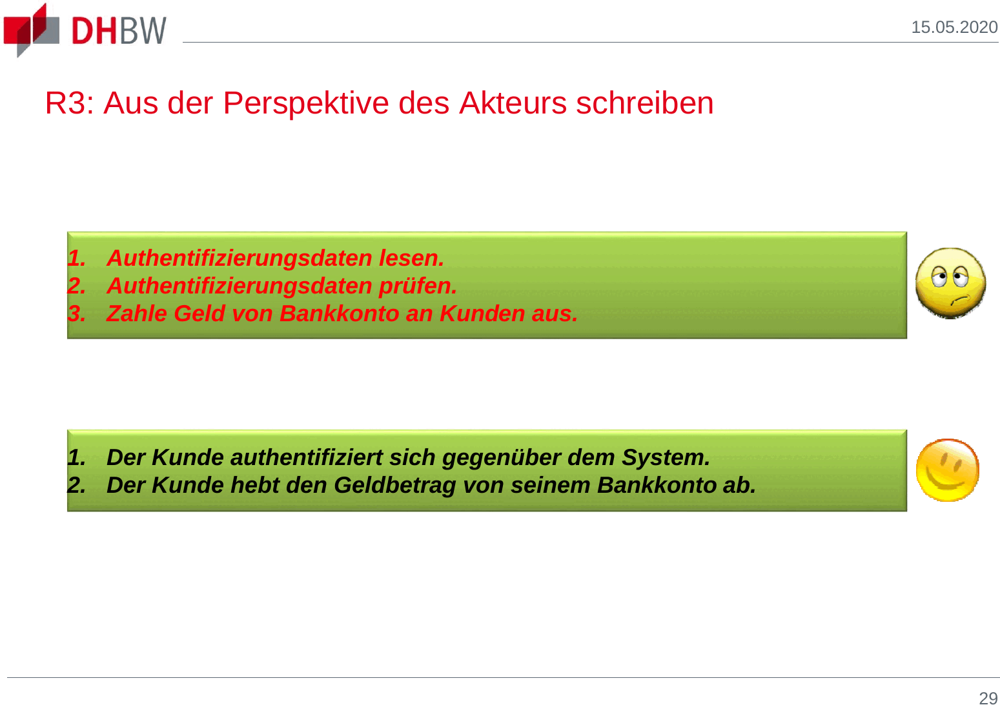

> 1. Authentifizierungsdaten lesen.
> 2. Authentifizierungsdaten prüfen.
> 3. Zahle Geld von Bankkonto an Kunden aus.

> 1. Der Kunde authentifiziert sich gegenüber dem System.
> 2. Der Kunde hebt den Geldbetrag von seinem Bankkonto ab.

## R4: Eine Aktivität sollte einen signifikanten Zwischenerfolg für den Akteur liefern.

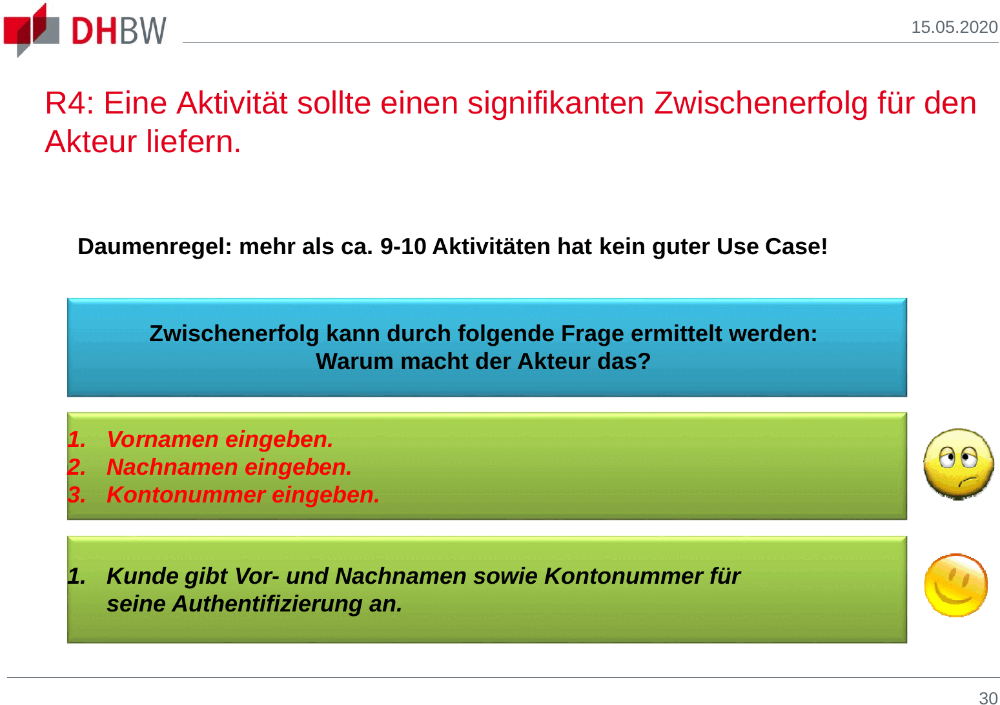

Daumenregel: mehr als ca. 9-10 Aktivitäten hat kein guter Use Case!

> Zwischenerfolg kann durch folgende Frage ermittelt werden:
> Warum macht der Akteur das?

> 1. Vornamen eingeben.
> 2. Nachnamen eingeben.
> 3. Kontonummer eingeben.

> 1. Kunde gibt Vor- und Nachnamen sowie Kontonummer für seine Authentifizierung an.

## R5: Die Absicht des Akteurs sollte in der Aktivitätsformulierung erkennbar werden.

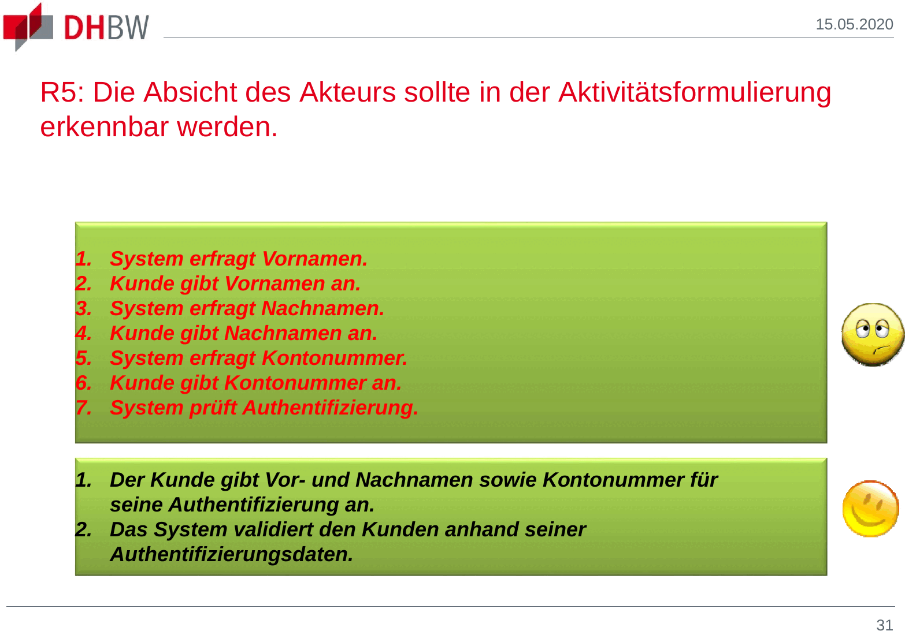

> 1. System erfragt Vornamen.
> 2. Kunde gibt Vornamen an.
> 3. System erfragt Nachnamen.
> 4. Kunde gibt Nachnamen an.
> 5. System erfragt Kontonummer.
> 6. Kunde gibt Kontonummer an.
> 7. System prüft Authentifizierung.

> 1. Der Kunde gibt Vor- und Nachnamen sowie Kontonummer für seine Authentifizierung an.
> 2. Das System validiert den Kunden anhand seiner Authentifizierungsdaten.

## R6: Ereignis-Reaktionsschema vollständig beschreiben

1. Der Akteur sendet Daten als auslösendes Ereignis.
2. Das System überprüft die Daten.
3. Das System reagiert auf die Daten.
4. Das System gibt das Ergebnis der Reaktion an den Akteur.

## R7: Validieren statt überprüfen

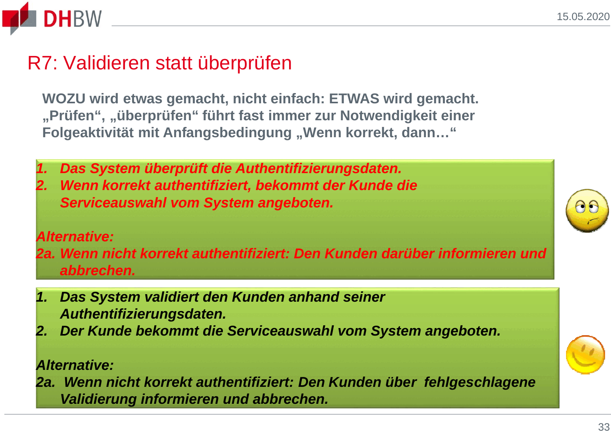

WOZU wird etwas gemacht, nicht einfach: ETWAS wird gemacht.
„Prüfen“, „überprüfen“ führt fast immer zur Notwendigkeit einer Folgeaktivität mit Anfangsbedingung „Wenn korrekt, dann…“

> 1. Das System überprüft die Authentifizierungsdaten.
> 2. Wenn korrekt authentifiziert, bekommt der Kunde die Serviceauswahl vom System angeboten.
>
> Alternative:
> 2a. Wenn nicht korrekt authentifiziert: Den Kunden darüber informieren und abbrechen.

> 1. Das System validiert den Kunden anhand seiner Authentifizierungsdaten.
> 2. Der Kunde bekommt die Serviceauswahl vom System angeboten.
>
> Alternative:
> 2a. Wenn nicht korrekt authentifiziert: Den Kunden über fehlgeschlagene Validierung informieren und abbrechen.

## R8: Wiederholungen

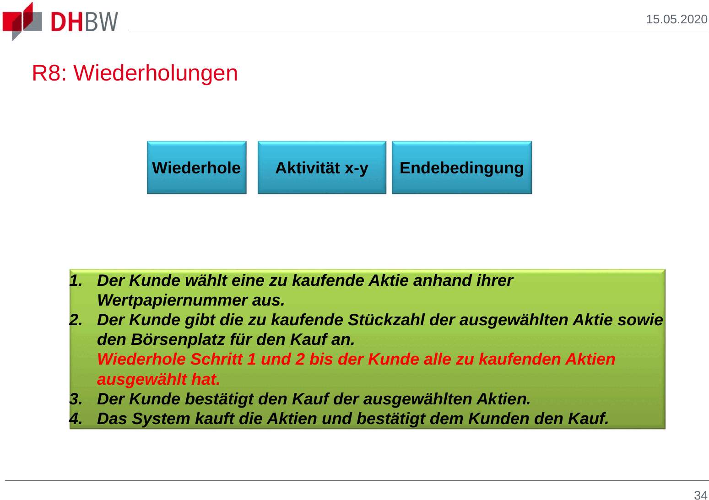

> Wiederhole — Aktivität x-y — Endebedingung

> 1. Der Kunde wählt eine zu kaufende Aktie anhand ihrer Wertpapiernummer aus.
> 2. Der Kunde gibt die zu kaufende Stückzahl der ausgewählten Aktie sowie den Börsenplatz für den Kauf an.
>    Wiederhole Schritt 1 und 2 bis der Kunde alle zu kaufenden Aktien ausgewählt hat.
> 3. Der Kunde bestätigt den Kauf der ausgewählten Aktien.
> 4. Das System kauft die Aktien und bestätigt dem Kunden den Kauf.

## Ein gut formulierter Use Case für UC #001 Neukunde erfassen

1. **Use Case**: #001 Neukunde erfassen.
2. **Ziel**: Ein neuer Kunde wurde erfasst.
3. **Vorbedingung**: es handelt sich um eine natürliche Person (Endkunde) und die Kundenstammdaten liegen vor.
4. **Nachbedingung Erfolg**: Die für Auftragsdurchführung und Kundenkommunikation notwendigen Stammdaten des neuen Kunden wurden erfasst und gespeichert.
5. **Nachbedingung Fehlschlag**: Der Kundenstammdatensatz wurde nicht im CRM-System angelegt. Die Gründe für den Fehlschlag wurden mitgeteilt.
6. **Akteur**: Kundensachbearbeiter.
7. **Auslösendes Ereignis**: Ein Kaufauftrag wurde durch einen Neukunden erteilt.
8. **Beschreibung**:
   1. Der Kundensachbearbeiter validiert die Kundenstammdaten (Vorname, Nachname, Lieferadresse, Rechnungsadresse, Geburtsdatum) auf Plausibilität und Vollständigkeit.
   2. Der Kundensachbearbeiter legt den neuen Kundenstammsatz im CRM-System an.
   3. Das CRM-System generiert die Kundennummer und speichert sie im Kundenstammsatz.

   **Alternativen**:
   - 2a. Die Validierung war nicht erfolgreich: Unter Angabe der Gründe für den Fehlschlag bricht der Kundensachbearbeiter den UC ab.

Quelle: systems-engineering/origin/WDS125 - Systems Engineering (BäM)/10 LE 7_ Use Cases - Modellierung der Anwendungsfälle/Folien der Lerneinheit/09.RE-UC.pdf, Seiten 1–35
